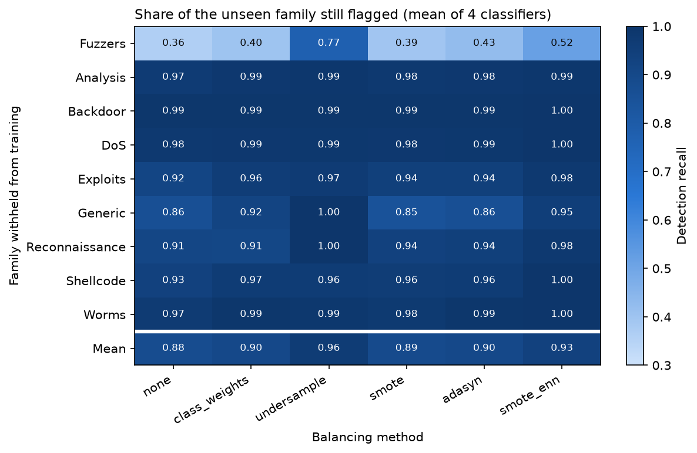
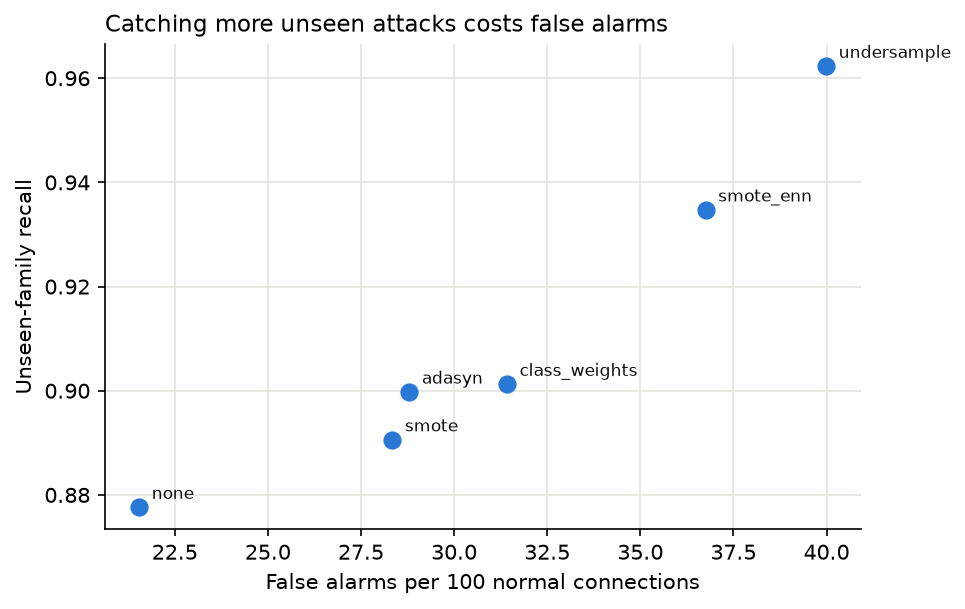

# E3: Leave-One-Attack-Out (O3)

Author: Max Siska

**Question:** If an attack family never appears in training, does balancing the training data help a detector still flag that family?

## Part A: Data and setup

**Setup:** I used the official UNSW-NB15 partitions after `preprocess.py`, which removed exact duplicates within each partition. Every learned transform was fitted on the training partition only.

| Split | Records | Normal records | Source |
|---|---:|---:|---|
| Training | 107,740 | 51,890 | Official training set |
| Test | 55,945 | 34,206 | Official testing set |

For each of the nine attack families, I removed every record of that family from training and left the test set unchanged. The withheld family therefore appears in testing as an attack the model never saw.

Each run combined one withheld family, one classifier, and one balancing method, giving $9 \times 4 \times 6 = 216$ runs. The classifiers were a decision tree, random forest, XGBoost, and MLP. The balancing methods were none, class weights, random undersampling, SMOTE, ADASYN, and SMOTE-ENN. Focal loss was excluded because `config.py` does not implement it yet.

All runs used `config.make_pipeline`, so scaling and resampling were fitted inside training only, and all random states used seed 42. Total fitting time across the 216 runs was 6,777 s.

**Training target:** I first trained binary normal versus attack detectors, then switched to family labels. After duplicate removal the binary target was close to balanced, with 51,890 normal records against 36,006 to 55,723 attack records depending on the withheld family. Balancing therefore changed almost nothing, and ADASYN failed when the gap was too small to generate samples. The real imbalance is between families, with 51,890 Normal records against 127 Worms.

Each model was trained on Normal plus the eight remaining families. A test record counted as flagged when its most probable class was any attack family, so a Worms record predicted as Shellcode still counts as detected. The attack score for ranking metrics was $1 - P(\text{Normal})$.

**Metrics:** The main metric is unseen recall, the fraction of the withheld family's test records that were flagged. Seen recall pools the other eight families' test records. All metrics came from the shared `evaluate.py` in binary mode. False alarms are reported per 100,000 normal test connections, recall, macro-F1, PR-AUC, and ROC-AUC are fractions.

| Withheld family | Test records |
|---|---:|
| Fuzzers | 4,838 |
| Analysis | 446 |
| Backdoor | 346 |
| DoS | 1,718 |
| Exploits | 7,609 |
| Generic | 3,657 |
| Reconnaissance | 2,703 |
| Shellcode | 378 |
| Worms | 44 |

## Part B: Results



Each value in the table below averages 36 runs, covering 4 classifiers and 9 withheld families.

| Method | Unseen recall | Seen recall | False alarms per 100k normal | Macro-F1 | PR-AUC | ROC-AUC |
|---|---:|---:|---:|---:|---:|---:|
| None | 0.8776 | 0.9427 | 21,546 | 0.8375 | 0.9213 | 0.9332 |
| Class weights | 0.9012 | 0.9704 | 31,423 | 0.7890 | 0.9157 | 0.9290 |
| Undersample | 0.9623 | 0.9816 | 39,990 | 0.7459 | 0.8190 | 0.8689 |
| SMOTE | 0.8906 | 0.9621 | 28,341 | 0.8041 | 0.9164 | 0.9292 |
| ADASYN | 0.8998 | 0.9611 | 28,801 | 0.8015 | 0.9145 | 0.9275 |
| SMOTE-ENN | 0.9347 | 0.9912 | 36,753 | 0.7664 | 0.8735 | 0.9005 |

The next table compares each method with no balancing on the same 36 family and classifier pairs. A change counts only when unseen recall moved by more than 0.01.

| Method | Pairs improved | Pairs worse | Pairs within 0.01 | Mean change in unseen recall |
|---|---:|---:|---:|---:|
| Class weights | 22 | 3 | 11 | +0.0236 |
| Undersample | 26 | 1 | 9 | +0.0847 |
| SMOTE | 16 | 4 | 16 | +0.0130 |
| ADASYN | 20 | 3 | 13 | +0.0221 |
| SMOTE-ENN | 26 | 1 | 9 | +0.0571 |

**Result:** Every balancing method raised mean unseen recall, with undersampling largest at +0.0847 and SMOTE smallest at +0.0130. False alarms rose with it, from 21,546 per 100k normal connections without balancing to 39,990 with undersampling.



The threshold independent metrics point the other way. ROC-AUC was highest without balancing (0.9332) and lowest with undersampling (0.8689), and macro-F1 followed the same order. The higher recall therefore came from flagging more traffic as attacks overall, not from separating attacks from normal traffic better.

### Rare families

Worms, Shellcode, Backdoor, and Analysis remained between 0.935 and 0.993 unseen recall without any balancing. Their traffic resembles the families still in training, so the models flagged them as some other attack. Rarity in training was not what made a family hard to detect once withheld.

### Fuzzers

Fuzzers was the clear exception. Its unseen recall was 0.3626 without balancing and stayed at or below 0.5176 for every method except undersampling, which reached 0.7729.

| Method | Fuzzers unseen recall |
|---|---:|
| None | 0.3626 |
| Class weights | 0.3993 |
| Undersample | 0.7729 |
| SMOTE | 0.3949 |
| ADASYN | 0.4251 |
| SMOTE-ENN | 0.5176 |

Withholding Fuzzers also lowered mean false alarms from 33,253 to 14,257 per 100k normal connections. Fuzzers traffic resembles normal traffic, so without Fuzzers in training the models label both as normal. With Fuzzers present, borderline normal connections get flagged too.

### Classifiers

| Classifier | None | Class weights | Undersample | SMOTE | ADASYN | SMOTE-ENN |
|---|---:|---:|---:|---:|---:|---:|
| Decision tree | 0.8425 | 0.8574 | 0.9606 | 0.8921 | 0.9052 | 0.9439 |
| Random forest | 0.8968 | 0.9260 | 0.9644 | 0.9137 | 0.9197 | 0.9338 |
| XGBoost | 0.8642 | 0.9008 | 0.9478 | 0.8399 | 0.8751 | 0.9277 |
| MLP | 0.9072 | 0.9208 | 0.9764 | 0.9168 | 0.8990 | 0.9335 |

Values are mean unseen recall over the nine withheld families. Without balancing, the classifiers ranged from 0.8425 to 0.9072. Undersampling put all four between 0.9478 and 0.9764, so the balancing method mattered more than the classifier. Only two averages fell below their unbalanced values, SMOTE with XGBoost (0.8399 against 0.8642) and ADASYN with the MLP (0.8990 against 0.9072).

## Part C: Caveats

In the raw training partition, 1,772 distinct feature vectors appear under more than one family label, covering 30,528 rows, mostly Exploits and DoS. When DoS is withheld, many DoS test records match training records labeled Exploits exactly, so DoS unseen recall overstates real generalization.

About 21.5% of normal test connections were flagged even without balancing. This fits the known distribution shift between the UNSW-NB15 training and testing partitions, but it should be compared with the false alarm rate from E1 on the full training data.

Limitations: Each configuration ran once with seed 42, so variability across seeds is unmeasured, and no significance tests have been run yet (E6). Every model used its default decision rule, and tuning a threshold on validation data could close much of the gap between methods. Focal loss is not included.

## Reproducing

```bash
python preprocess.py
python e3_leave_one_out.py
```

The last command trains all 216 runs and resumes if stopped. It writes `results/e3_leave_one_out.csv` with one row per run, along with `figures/e3_unseen_recall.png` and `figures/e3_tradeoff.png`.
