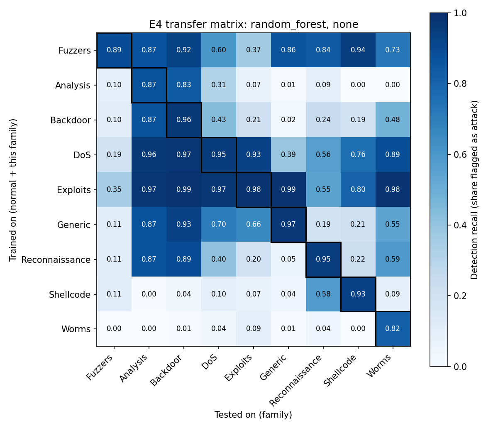

# E4: Transfer matrix (O3)

E3 shows which attack families are missed when they are withheld from
training, but not why. E4 addresses this by measuring how well a detector
trained on one attack family generalizes to the others. For each of the nine
families, we train a binary detector on normal traffic plus that family only,
score it on the full official test set, and record the detection recall for
every family. The result is a 9 x 9 matrix in which rows are the training
(source) family and columns are the test (target) family.

The diagonal measures detection of the family the model was trained on and
serves as a baseline. The off-diagonal cells measure transfer to unseen
families. High transfer from one family to another suggests the two share
feature patterns. A family with low recall from every other source has no
close neighbor in feature space, so we expect it to be among the families E3
fails to detect.

## Setup

Each training set contains all Normal records from the official training
partition plus the records of one source family, with exact duplicates
removed as in E2. Labels are binary (0 = normal, 1 = attack). Models are built
with `make_pipeline()` from `config.py`, so scaling and resampling are fit on
training data only.

The decision threshold follows the same procedure as E2: 5-fold out-of-fold
predictions on the training subset, with the cutoff chosen to maximize attack
F1 (`choose_threshold` from `e2_rare_family.py`). Test labels are never used
for threshold selection.

Scoring uses `evaluate_predictions()` from `evaluate.py` on the full test set,
which returns per-family detection recall for all nine families in a single
call, along with false positives per 100,000 normal connections.

The default configuration runs Random Forest and XGBoost, each with no
balancing and with SMOTE.

## Running

    python e4_transfer.py                      # official CSVs in data/ (default)
    python e4_transfer.py --processed          # uses processed/ CSVs (faster)
    python e4_transfer.py --classifiers xgboost --methods none smote
    python -m unittest -v test_e4              # unit tests on synthetic data

Results are appended as each run completes, and completed configurations are
skipped on rerun, so an interrupted run can be resumed with the same command.

## Outputs (in `results/`)

- `e4_transfer.csv`: one row per source family, target family, classifier,
  and method, with detection recall, target test support, threshold, false
  alarms, and ROC-AUC.
- `e4_transfer_coverage.csv`: for each target family, the highest detection
  recall achieved by a model that never trained on it, and the source family
  responsible. Low values identify families not covered by any other family.
- `e4_transfer_<classifier>_<method>.png`: heatmap of the matrix for each
  configuration, with the diagonal outlined.

## Limitations

- `--processed` mode reuses preprocessing fit on the entire training
  partition, so it is not fully isolated from the validation folds. Final
  results should use the default raw mode, which fits preprocessing on each
  training subset.
- Each detector is trained on a single attack family, so its false alarm rate
  can differ substantially from the E1 and E3 models trained on all families.
  False alarms should be reported alongside every transfer result.
- The test set contains only 44 Worms records, so one prediction changes Worms
  recall by about 2.3 percentage points.
- As in E2 and E3, the 3.63% train/test overlap is retained (see the
  preprocessing report).

  ## Results

Every detector caught the family it was trained on (diagonal recall 0.80 to
0.98). Transfer to unseen families varied widely and was strongly asymmetric.
Detectors trained on broad families transferred well: the Exploits detector
flagged at least 0.94 of Analysis, Backdoor, DoS and Worms across all four
configurations. Detectors trained on narrow families transferred poorly: the
Worms detector flagged at most 0.10 of any other family, and the Shellcode
detector transferred only to Reconnaissance (0.57 to 0.70). Analysis and
Backdoor detected each other well (0.82 to 0.87).

**E4 explains E3.** Fuzzers was the only family that no other detector
covered. Its best unseen recall was 0.35 (Exploits detector, Random Forest),
which matches its E3 unseen recall of 0.36 without balancing. Every other
family, including the four rare ones, was covered by at least one other
family at 0.87 or higher, consistent with E3's finding that rarity alone did
not make a family hard to detect once withheld.

**False alarms.** The Fuzzers detector flagged 24,744 to 26,054 per 100,000
normal connections, about seven times more than any other detector, so its
broad coverage comes largely from flagging a quarter of normal traffic. This
supports E3's observation that Fuzzers traffic resembles normal traffic. The
Exploits detector achieved its coverage at about 3,300 false alarms per
100,000, making it the strongest general-purpose detector. The narrow
detectors were the most conservative (Worms: 18 to 82; Backdoor: 53 to 108).

**SMOTE did not reliably improve transfer.** Most cells changed by less than
0.05. Where SMOTE had a larger effect, the direction depended on the
classifier: with Random Forest it lowered Exploits to Generic from 0.99 to
0.49, while with XGBoost it raised DoS to Generic from 0.52 to 0.97. SMOTE
also increased false alarms for most detectors (for example, Analysis with
Random Forest rose from 1,684 to 2,973). Balancing a single source family
therefore does not consistently help a detector generalize to unseen families.