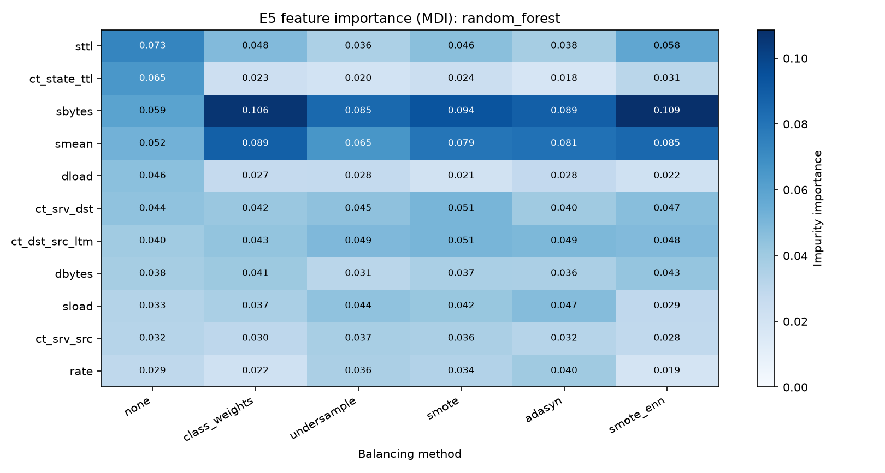
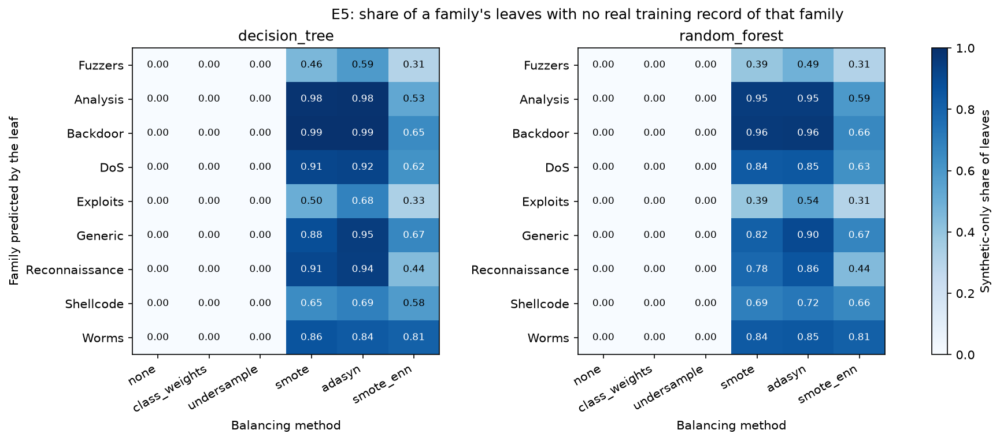

# E5: Rule extraction (O1, O3)

E1 to E4 measure *whether* balancing changes detection. E5 asks *how*: what
does resampling do to the decision boundaries of the two tree models? For the
Decision Tree and Random Forest, trained with no balancing and with each of the
five balancing methods (class weights, undersampling, SMOTE, ADASYN,
SMOTE-ENN; focal loss is XGBoost-only), we compare feature importances, the
rules the trees use, and how much of each tree's structure is built from
synthetic rather than real records. All 12 configurations are complete.

## Setup

Data handling follows E2 and E4. We use the official raw CSVs with exact
duplicates removed within each partition (107,740 training and 55,945 test
records). Preprocessing is fitted on the training data only. Models are built
with `make_pipeline()` from `config.py` (scaler, then resampler, then
classifier), so resampling only touches training data.

As in E2 and E3, the models are trained on **family labels** (Normal plus the
nine attack families). After deduplication the binary target is close to
balanced, so balancing only has an effect at the family level, where 51,890
Normal records sit alongside 127 Worms. Attack detection uses the score
1 − P(Normal). Its threshold is chosen on 5-fold out-of-fold training
predictions to maximize attack F1 (`choose_threshold` from
`e2_rare_family.py`). Test labels are never used to choose anything.

Each configuration produces the following:

- **Feature importances.** Impurity (MDI) importance for every feature. For
  the Random Forest we also record the share of its 200 trees whose root split
  uses each feature.
- **Rules.** The top three levels of each tree, plus the five leaf rules with
  the most real training support for each rare family and for Fuzzers (the
  family E3 and E4 miss). Thresholds are converted back to original units by
  undoing the pipeline scaler and `log1p`. The Random Forest has 200 deep
  trees, so its readable rules come from a surrogate tree fitted to the
  forest's predictions on the real training rows (see
  [Surrogate for the forest](#surrogate-for-the-forest)).
- **Synthetic-only leaves.** A leaf predicting family F is *synthetic-only*
  if no real training record of F reaches it, meaning the region exists only
  because of SMOTE or ADASYN records. We report the share of each family's
  leaves that are synthetic-only, and the share of each family's test records
  that land in such leaves. Forest values are averaged over trees.
- **Scores.** Per-family detection recall at the tuned threshold and false
  alarms per 100,000 normal connections (binary `evaluate_predictions`), plus
  per-family classification precision and recall (multiclass
  `evaluate_predictions`, argmax).

### Surrogate for the forest

The surrogate is a single tree grown best-first to 256 leaves, without class
weights. We chose it by agreement with the forest on a 20% stratified holdout
of the *real training rows* (the no-balancing forest), not on the test set:

| Surrogate leaves | Class weights | Holdout agreement | Test agreement | Depth |
|---:|---|---:|---:|---:|
| 64 | balanced | 0.738 | 0.697 | 13 |
| 64 | none | 0.795 | 0.806 | 14 |
| 128 | balanced | 0.758 | 0.722 | 18 |
| 128 | none | 0.808 | 0.837 | 19 |
| **256** | **none** | **0.827** | **0.854** | **21** |
| 512 | none | 0.846 | 0.870 | 26 |

The earlier draft used 64 balanced leaves, which agreed with the forest on
only 69.7% of test records. Balanced weights give the rare families more
leaves but cost a lot of overall fidelity. 512 leaves adds under two points
for five more levels of depth, so we kept 256. Because overall agreement hides
the small families, `e5_families.csv` also reports **per-family fidelity**:
the share of test records the forest assigns to a family that the surrogate
assigns to the same family. The rule files print it next to each family.

Fidelity is capped by the data, not only by surrogate size: 7.9% of
deduplicated training rows (8,472) have an identical feature vector carrying a
*different* family label. This hits Analysis (1,201 of 1,594 records, 75%) and
Backdoor (1,132 of 1,535, 74%) hardest, and it is why even the forest agrees
with the training labels on only 93.8% of its own training rows.

## Running

    python e5_rules.py                                   # official CSVs in data/ (default)
    python e5_rules.py --processed                       # processed/ CSVs (faster)
    python e5_rules.py --classifiers random_forest --methods none smote
    python -m unittest -v test_e5                        # unit tests on synthetic data

Results are appended as each configuration completes, and completed
configurations are skipped on rerun, so an interrupted run can be resumed with
the same command. The tables and figures that compare configurations are
rebuilt from the saved CSVs at the end of every run.

The full run (all 12 configurations) took 71 minutes on a 16-core Windows 11
laptop (Python 3.14, scikit-learn 1.9.1, imbalanced-learn 0.14.2, XGBoost
3.4.1). SMOTE-ENN takes most of that time (25 minutes for the Decision Tree,
28 for the forest), because ENN runs a nearest-neighbor search over about
519,000 oversampled rows in each of the six fits. Everything else finishes in
under 6 minutes per configuration.

**Environment note (macOS).** `config.py` imports XGBoost. Without Homebrew
`libomp`, current XGBoost wheels fail to load. Either run `brew install
libomp`, or use `xgboost==2.0.3` with scikit-learn's bundled OpenMP library:

    export DYLD_LIBRARY_PATH="$PWD/.venv/lib/python3.13/site-packages/sklearn/.dylibs"

**Reproducibility note.** An earlier partial run on macOS with older library
versions gave identical results for no balancing, class weights and
undersampling. SMOTE and ADASYN results differed slightly (for example, 74,912
vs 74,863 Decision Tree leaves with SMOTE), most likely because of
nearest-neighbor tie-breaking. The conclusions below hold in both runs.

## Outputs

Tables are written to `results/` and figures to `figures/`.

- `e5_summary.csv`: one row per classifier and method, with threshold, false
  alarms, macro-F1, ROC-AUC, rare-family detection and classification
  recall/precision, tree size and depth, and surrogate fidelity (overall and
  mean over the rare families).
- `e5_families.csv`: one row per classifier, method and family, with leaves,
  synthetic-only leaves, test share in synthetic-only leaves, detection recall,
  classification precision/recall/F1, test support, and per-family surrogate
  fidelity.
- `e5_importances.csv`: MDI importance, rank and root-split share for every
  feature.
- `e5_importance_shift.csv`: for each configuration versus no balancing,
  Spearman rank correlation of importances, top-10 overlap, and the features
  with the largest gain and loss.
- `e5_rules.csv` and `e5_rules/<classifier>_<method>.txt`: readable rules,
  with real training support and the number of test family and Normal records
  reaching each leaf (descriptive only).
- `figures/e5_importance_<classifier>.png`: importance heatmap of each
  method's top features.
- `figures/e5_synthetic_leaves.png`: synthetic-only share of each family's
  leaves by method.

## Results

Rare values pool or average Worms, Shellcode, Backdoor and Analysis. Detection
recall counts a record as caught if it is flagged as any attack. Classification
recall requires the correct family.

**Decision Tree**

| Method | Leaves | Depth | False alarms per 100k | Rare detection recall | Rare classification recall | Rare classification precision | ROC-AUC |
|---|---:|---:|---:|---:|---:|---:|---:|
| None | 10,670 | 60 | 24,233 | 0.976 | 0.367 | 0.247 | 0.843 |
| Class weights | 12,804 | 64 | 23,309 | 0.975 | 0.534 | 0.232 | 0.847 |
| Undersample | 352 | 23 | 39,014 | 0.997 | 0.599 | 0.078 | 0.795 |
| SMOTE | 74,863 | 90 | 26,206 | 0.992 | 0.428 | 0.166 | 0.842 |
| ADASYN | 98,617 | 89 | 27,668 | 0.979 | 0.387 | 0.188 | 0.833 |
| SMOTE-ENN | 12,465 | 56 | 37,362 | 1.000 | 0.531 | 0.157 | 0.806 |

**Random Forest** (leaves and depth are means over 200 trees; fidelity is the
256-leaf surrogate's test agreement with the forest)

| Method | Leaves | Depth | False alarms per 100k | Rare detection recall | Rare classification recall | Rare classification precision | ROC-AUC | Surrogate fidelity (all / rare) |
|---|---:|---:|---:|---:|---:|---:|---:|---:|
| None | 11,147 | 43.6 | 26,279 | 0.995 | 0.322 | 0.251 | 0.969 | 0.854 / 0.536 |
| Class weights | 8,693 | 43.2 | 27,940 | 0.997 | 0.606 | 0.279 | 0.966 | 0.902 / 0.686 |
| Undersample | 345 | 21.5 | 40,817 | 0.998 | 0.682 | 0.081 | 0.921 | 0.923 / 0.837 |
| SMOTE | 51,409 | 65.2 | 28,214 | 0.999 | 0.526 | 0.240 | 0.966 | 0.830 / 0.503 |
| ADASYN | 62,323 | 65.6 | 28,206 | 0.999 | 0.496 | 0.232 | 0.967 | 0.816 / 0.390 |
| SMOTE-ENN | 15,895 | 48.4 | 31,269 | 0.976 | 0.583 | 0.189 | 0.917 | 0.922 / 0.652 |

### 1. Oversampling rebuilds both models mostly from synthetic data

SMOTE made the Decision Tree seven times larger (10,670 to 74,863 leaves) and
ADASYN nine times larger (98,617). Each forest tree grew 4.6 times (SMOTE) and
5.6 times (ADASYN). Most of the new leaves contain no real record of the family
they predict. With SMOTE, the synthetic-only share of rare-family leaves is:

| Family | Decision Tree | Random Forest |
|---|---:|---:|
| Analysis | 98% | 95% |
| Backdoor | 99% | 96% |
| Worms | 86% | 84% |
| Shellcode | 65% | 69% |

ADASYN is similar or higher. SMOTE-ENN is lower (53% to 81%) because ENN then
removes synthetic records that sit among other classes, which also shrinks the
models back to roughly unbalanced size (12,465 and 15,895 leaves). Without
balancing, with class weights and with undersampling, no leaf is
synthetic-only, as expected.

These invented regions matter at test time. In the SMOTE Decision Tree, 45% of
Backdoor, 36% of Analysis, 25% of Worms and 16% of Shellcode test records were
classified in a synthetic-only leaf. For the SMOTE forest (averaged over
trees) the figures are 53%, 39%, 18% and 19%. So do 1.4% of normal test
records in the tree and 2.5% in the forest (1.6% and 3.2% with ADASYN). Those
normal records are false alarms caused directly by regions that exist only
because of synthetic data.

The single-tree rules show how this happens. The SMOTE tree's best Worms leaf
resembles the unbalanced tree's (high `sttl`, `sbytes` about 1,290 to 1,310,
low `ct_dst_src_ltm`) and holds 21 real Worms records (the unbalanced leaf
holds 22). But it was fitted on 10,254 rows, so 99.8% of its support is
synthetic. The rules
themselves also got longer: the median rare-family or Fuzzers rule has 12
conditions without balancing and 18 with SMOTE.

### 2. The splits that separate normal from attack move

**Decision Tree.** In the unbalanced tree, the root split is `sttl <= 61`,
which sends 39,806 training rows to Normal, and `sttl` carries 0.324 of the
total importance. Every balancing method cuts that to 0.103 to 0.169.
Importance shifts to size and timing features: `sbytes` becomes the top
feature with class weights, undersampling and SMOTE, and `smean` gains the
most under undersampling, SMOTE and ADASYN (0.037 to 0.083 to 0.107). With
SMOTE and SMOTE-ENN the root threshold drops to `sttl <= 33.4`. The two
largest branches below it become a Worms region (143,894 fit rows with SMOTE)
and a Shellcode region (290,367 fit rows), almost all synthetic, where the
unbalanced tree had a Fuzzers region of 51,443 real rows. Spearman correlation
with the unbalanced importances is 0.82 to 0.87, and only 6 to 8 of the top 10
features are shared.

**Random Forest.** The forest shows the same shift, only smaller. Without
balancing, importance is spread out: `sttl` ranks first at only 0.073, followed
by `ct_state_ttl` (0.065), `sbytes`, `smean` and `dload`. Every balancing
method moves `sbytes` to first (0.085 to 0.109) and `smean` to second (0.065
to 0.089). The TTL features lose the most: `sttl` falls to 0.036 to 0.058 and
`ct_state_ttl` (the largest loss in every configuration) to 0.018 to 0.031.
Spearman correlation stays high (0.92 to 0.95) because the forest's
importances are flat, but top-10 overlap drops to 4 (undersampling) to 8
(SMOTE-ENN).

The *top* of the forest barely moves. Root splits use `ct_state_ttl`
(11 to 12% of trees) and `sttl` (10 to 12%) under every method. Every
surrogate starts with the same TTL split that sends about 39,800 rows to
Normal (`sttl <= 61`; `sttl <= 45.5` with undersampling). The change is one
level lower. Under every balancing method, the surrogate splits the large
low-`dbytes` attack branch on `ct_dst_src_ltm` instead of `service = dns`.
With SMOTE, that gives 18,458 rows assigned to Exploits and 36,717 to Fuzzers.
Bagging and random feature subsets keep the forest's early splits stable, so
balancing reshapes the forest deeper in the trees, where the synthetic regions
lie.

The forest's rare-family rules from real data survive resampling. The best
Worms rule is nearly identical with and without SMOTE (`sttl > 158`,
`dbytes <= 1407`, `sbytes` about 1,270 to 1,310, `dpkts <= 13`,
`service = http`). It matches 18 and 22 of the 44 Worms test records and no
normal records. SMOTE adds synthetic regions *around* the real-data rules
rather than replacing them.

### 3. Effect on O1 (rare-family recall)

Binary rare detection was already 0.976 (tree) and 0.995 (forest) without
balancing, so there was little room to gain. The gains are in *classification*
recall, and they come with lower precision or more false alarms:

- **Undersampling** gives the highest rare classification recall (0.599 tree,
  0.682 forest), but precision collapses to 0.08 and false alarms rise by
  about 15,000 per 100k for both models. With only 345 to 352 leaves, the
  model has a few coarse rare-family regions that also capture large amounts
  of normal traffic.
- **SMOTE and ADASYN** raise rare classification recall less (0.43 and 0.39
  tree, 0.53 and 0.50 forest) and lower precision, at 2,000 to 3,500 extra
  false alarms per 100k, through the synthetic regions described above.
- **SMOTE-ENN** behaves like a milder form of undersampling (rare
  classification recall 0.53 tree and 0.58 forest), but false alarms rise by
  5,000 to 13,000 per 100k.
- **Class weights** give the best trade-off for both models. In the tree,
  rare classification recall rises from 0.367 to 0.534 with *fewer* false
  alarms (23,309). In the forest it rises from 0.322 to 0.606 with higher
  precision (0.279 vs 0.251) for 1,661 extra false alarms per 100k. Class
  weights create no synthetic regions: they move boundaries using only real
  records.

Analysis and Backdoor remain poorly classified under every method
(classification precision 0.04 to 0.13). Most of their records have exact
feature twins in other families (see the surrogate section), so no
resampling method can separate them. Balancing only moves the boundary within
the overlap, trading one family's errors for another's.

### 4. Effect on O3 (Fuzzers)

In the unbalanced tree, Fuzzers falls in the large
`sttl > 61, dbytes <= 1407, service != dns` branch (51,443 rows) together with
other low-volume attacks. Its best leaf rules also let normal records through.
Rule 2 matches 9 Fuzzers and 27 Normal test records, and rule 4 matches no
Fuzzers and 17 Normal. Fuzzers has the lowest synthetic-only leaf share of any
attack family under SMOTE (46% tree, 39% forest, tied with Exploits),
because its 16,150 real training records leave little empty space to fill. Its
detection recall barely moves with SMOTE or ADASYN (tree 0.720 to 0.784 and
0.767; forest 0.897 to 0.892 and 0.883). Only the methods that remove data
raise it substantially: undersampling (0.939 tree, 0.955 forest) and SMOTE-ENN
in the tree (0.946). Both cost 37,000 to 41,000 false alarms per 100k.

This agrees with E3 and E4: Fuzzers is hard because it overlaps normal traffic
in feature space, not because it is rare. Adding synthetic records does not
separate it. Only lowering the bar for "attack" in that region catches more
Fuzzers, and that lets normal traffic through at the same rate.

## Summary

- Oversampling does not sharpen the existing boundaries. It adds new regions:
  84% to 99% of the leaves for Worms, Backdoor and Analysis under SMOTE or
  ADASYN contain no real record of that family, and 16% to 53% of those
  families' test records are classified there.
- Balancing of every kind moves importance away from TTL features (`sttl`,
  `ct_state_ttl`), which dominate the normal/attack split, towards packet size
  (`sbytes`, `smean`). The single tree is reshaped from the root down. The
  forest keeps its first splits and changes deeper down.
- For O1, class weights give the best recall-for-false-alarm trade-off in both
  trees, and they do it without synthetic regions. For O3, balancing does not
  fix Fuzzers, because the problem is overlap with normal traffic, not
  rarity.

## Limitations

- Each configuration is fitted once with seed 42, with no variance estimate
  and no significance test (E6).
- MDI importance is computed on the data the model was fitted on, which for
  SMOTE and ADASYN is mostly synthetic. That is intended here, since it shows
  where the resampled model draws its boundaries. MDI is also known to favor
  continuous, high-cardinality features.
- Unpruned trees have long rules (median 9 to 18 conditions for the single tree; the forest surrogates' rules have 8 to 10), so the rule
  files are for inspection, not for deployment as signatures.
- Forest rules come from a surrogate with 0.82 to 0.92 overall test
  agreement, but lower agreement on some rare families (Backdoor 0.24 and Worms
  0.58 without balancing; see `surrogate_fidelity` in `e5_families.csv`).
  Forest rules for low-fidelity families should be read as approximate.
- `--processed` mode reuses preprocessing fitted on the full training
  partition. The results here use the default raw mode.
- As in E2 to E4, the 3.63% train/test overlap is retained, and the test set
  has only 44 Worms records.
