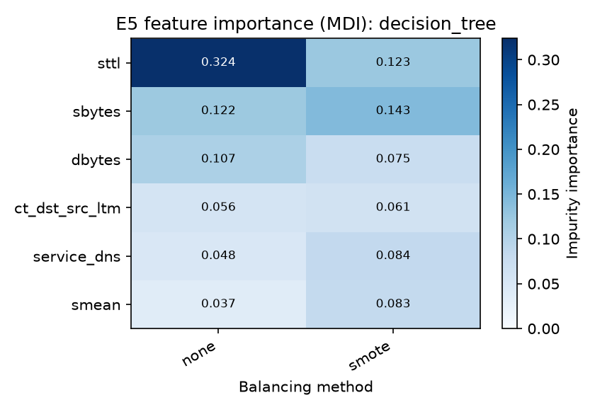

# E5: Rule extraction (O1, O3)

> **Status: in progress.** Decision Tree results are complete for five of the
> six methods. Random Forest is complete for no balancing only. See
> [Remaining work](#remaining-work) at the end before continuing.

E1 to E4 measure *whether* balancing changes detection. E5 asks *how*: what
does resampling do to the decision boundaries of the two tree models? For the
Decision Tree and Random Forest, trained with no balancing and with each
balancing method, we compare feature importances, the rules the trees use, and
how much of each tree's structure is built from synthetic rather than real
records.

## Setup

Data handling follows E2 and E4. We use the official raw CSVs with exact
duplicates removed within each partition (107,740 training and 55,945 test
records). Preprocessing is fitted on the training data only. Models are built
with `make_pipeline()` from `config.py` (scaler, then resampler, then
classifier), so resampling only touches training data.

As in E2 and E3, the models are trained on **family labels** (Normal plus the
nine attack families). After deduplication the binary target is close to
balanced, so balancing only has an effect at the family level, where 51,890
Normal records sit alongside 127 Worms. Attack detection uses the score
1 − P(Normal). Its threshold is chosen on 5-fold out-of-fold training
predictions to maximize attack F1 (`choose_threshold` from
`e2_rare_family.py`). Test labels are never used to choose anything.

Each configuration produces the following:

- **Feature importances.** Impurity (MDI) importance for every feature. For
  the Random Forest we also record the share of its 200 trees whose root split
  uses each feature.
- **Rules.** The top three levels of each tree, plus the five leaf rules with
  the most real training support for each rare family and for Fuzzers (the
  family E3 and E4 miss). Thresholds are converted back to original units by
  undoing the pipeline scaler and `log1p`. The Random Forest has 200 deep
  trees, so its readable rules come from a surrogate tree (64 leaves, grown
  best-first, balanced class weights) fitted to the forest's predictions on
  the real training rows. Its agreement with the forest on the test set is
  reported as `surrogate_fidelity`.
- **Synthetic-only leaves.** A leaf predicting family F is *synthetic-only*
  if no real training record of F reaches it, meaning the region exists only
  because of SMOTE or ADASYN records. We report the share of each family's
  leaves that are synthetic-only, and the share of each family's test records
  that land in such leaves. Forest values are averaged over trees.
- **Scores.** Per-family detection recall at the tuned threshold and false
  alarms per 100,000 normal connections (binary `evaluate_predictions`), plus
  per-family classification precision and recall (multiclass
  `evaluate_predictions`, argmax).

## Running

    python e5_rules.py                                   # official CSVs in data/ (default)
    python e5_rules.py --processed                       # processed/ CSVs (faster)
    python e5_rules.py --classifiers random_forest --methods none smote
    python -m unittest -v test_e5                        # unit tests on synthetic data

Results are appended as each configuration completes, and completed
configurations are skipped on rerun, so an interrupted run can be resumed with
the same command. The tables and figures that compare configurations are
rebuilt from the saved CSVs at the end of every run.

**Environment note (macOS).** `config.py` imports XGBoost. Without Homebrew
`libomp`, current XGBoost wheels fail to load. These results were produced in a
local `.venv` with `xgboost==2.0.3` (which still satisfies `requirements.txt`)
and scikit-learn's bundled OpenMP library:

    export DYLD_LIBRARY_PATH="$PWD/.venv/lib/python3.13/site-packages/sklearn/.dylibs"

`brew install libomp` is the cleaner fix.

## Outputs

Tables are written to `results/` and figures to `figures/`.

- `e5_summary.csv`: one row per classifier and method, with threshold, false
  alarms, macro-F1, ROC-AUC, rare-family detection and classification
  recall/precision, tree size and depth, and surrogate fidelity.
- `e5_families.csv`: one row per classifier, method and family, with leaves,
  synthetic-only leaves, test share in synthetic-only leaves, detection recall,
  classification precision/recall/F1, and test support.
- `e5_importances.csv`: MDI importance, rank and root-split share for every
  feature.
- `e5_importance_shift.csv`: for each configuration versus no balancing,
  Spearman rank correlation of importances, top-10 overlap, and the features
  with the largest gain and loss.
- `e5_rules.csv` and `e5_rules/<classifier>_<method>.txt`: readable rules,
  with real training support and the number of test family and Normal records
  reaching each leaf (descriptive only).
- `figures/e5_importance_<classifier>.png`: importance heatmap of each
  method's top features.
- `figures/e5_synthetic_leaves.png`: synthetic-only share of each family's
  leaves by method.

## Results (Decision Tree)

| Method | Leaves | Depth | False alarms per 100k | Rare detection recall | Rare classification recall | Rare classification precision | ROC-AUC |
|---|---:|---:|---:|---:|---:|---:|---:|
| None | 10,670 | 60 | 24,233 | 0.976 | 0.367 | 0.247 | 0.843 |
| Class weights | 12,804 | 64 | 23,309 | 0.975 | 0.534 | 0.232 | 0.847 |
| Undersample | 352 | 23 | 39,014 | 0.997 | 0.599 | 0.078 | 0.795 |
| SMOTE | 74,912 | 87 | 26,010 | 0.990 | 0.435 | 0.167 | 0.843 |
| ADASYN | 98,154 | 114 | 27,837 | 0.975 | 0.385 | 0.189 | 0.832 |

Rare values pool or average Worms, Shellcode, Backdoor and Analysis.

**Oversampling rebuilds the tree mostly from synthetic data.** SMOTE made the
tree seven times larger (10,670 to 74,912 leaves) and ADASYN nine times larger
(98,154). Most of the new leaves contain no real record of the family they
predict. With SMOTE, 98% of Analysis leaves, 99% of Backdoor leaves, 86% of
Worms leaves and 65% of Shellcode leaves are synthetic-only. ADASYN is similar
or higher. Without balancing, with class weights and with undersampling, no
leaf is synthetic-only, as expected. These invented regions matter at test
time. With SMOTE, 51% of Backdoor, 38% of Analysis, 25% of Worms and 16% of
Shellcode test records were classified in a synthetic-only leaf, along with
1.4% of normal test traffic (1.8% with ADASYN).

**The splits that separate normal from attack move.** In the unbalanced tree,
the first split is `sttl <= 61`, which sends 39,806 training rows to Normal,
and `sttl` carries 0.324 of the total importance. Every balancing method
roughly halves or cuts that further (0.103 to 0.140). Importance spreads to
size and timing features such as `smean` (0.037 to 0.083–0.110), `sinpkt`,
`sload` and `rate`. With SMOTE the root threshold drops to `sttl <= 33.4`, and
the two largest branches below it become a Worms region with 143,894 fit rows
and a Shellcode region with 290,367 fit rows, almost all synthetic. Spearman
correlation between the SMOTE and unbalanced importances is 0.87, and only 6 of
the top 10 features are shared.

**Effect on O1.** The larger rare-family regions raised rare classification
recall (0.367 to 0.435 with SMOTE, 0.599 with undersampling) and lowered
precision (0.247 to 0.167 and 0.078). Binary rare detection was already 0.976
without balancing, so there was little room left to gain (0.990 with SMOTE).
False alarms rose with every method except class weights. Class weights gave
the best trade-off for the Decision Tree: rare classification recall rose to
0.534 with slightly fewer false alarms (23,309) and no synthetic regions.

**Effect on O3 (Fuzzers).** In the unbalanced tree, Fuzzers falls in the large
`sttl > 61, dbytes <= 1407, service != dns` branch (51,443 rows) together with
other low-volume attacks. Its best leaf rules also let normal records through
(for example, rule 2 matches 9 Fuzzers and 27 Normal test records). Fuzzers has
the lowest synthetic-only share of any attack family under SMOTE (46%), and its
detection recall barely moved (0.720 to 0.783). Only undersampling raised it
substantially (0.939), and at 39,014 false alarms per 100k. This agrees with
E3 and E4: Fuzzers is hard because it overlaps normal traffic in feature
space, not because it is rare, so adding synthetic records does not separate
it.

## Results (Random Forest), partial

Only the no-balancing forest is complete: 200 trees averaging 11,147 leaves and
depth 43.6, with 26,279 false alarms per 100k, rare detection recall 0.995 and
ROC-AUC 0.969. Its importances are much flatter than the single tree's.
`sttl` ranks first at only 0.073, followed by `ct_state_ttl` (0.065),
`sbytes`, `smean` and `dload`. Root splits are spread across `ct_state_ttl`
(12.0% of trees), `sttl` (11.5%) and `dload` (9.5%). Its surrogate agrees with
the forest on only 69.7% of test records (see Remaining work), so the forest
rules in `results/e5_rules/random_forest_none.txt` should be read with caution.

## Limitations

- Each configuration is fitted once with seed 42, with no variance estimate
  and no significance test (E6).
- MDI importance is computed on the data the model was fitted on, which for
  SMOTE and ADASYN is mostly synthetic. That is intended here, since it shows
  where the resampled model draws its boundaries. MDI is also known to favor
  continuous, high-cardinality features.
- Unpruned trees have very long rules (often 15 to 25 conditions), so the rule
  files are for inspection, not for deployment as signatures.
- `--processed` mode reuses preprocessing fitted on the full training
  partition. Final results should use the default raw mode.
- As in E2 to E4, the 3.63% train/test overlap is retained, and the test set
  has only 44 Worms records.

## Remaining work

Pick up from here. Nothing has been committed. The new files are
`e5_rules.py`, `test_e5.py`, this write-up, and the figures in `figures/`.

1. **Finish the Random Forest run.** Random Forest with SMOTE was still
   running when this was written. Check `results/e5_summary.csv`. If the
   `random_forest,smote` row is missing, rerun (completed configurations are
   skipped):

       python e5_rules.py --classifiers random_forest --methods none smote

   Optional, but needed for a full before/after table: run the other methods
   with `python e5_rules.py`. The Decision Tree with SMOTE-ENN and the Random
   Forest with class weights, undersampling, ADASYN and SMOTE-ENN are not run
   yet. SMOTE-ENN and the oversampled forests are slow (likely 1 to 2 hours in
   total on a laptop).
2. **Fill in the Random Forest results** above: summary table, importance
   figure (`figures/e5_importance_random_forest.png`), synthetic-only leaf
   shares, and whether the forest shows the same `sttl` shift and synthetic
   leaves as the single tree.
3. **Check surrogate fidelity.** The 64-leaf balanced surrogate agrees with
   the no-balancing forest on only 69.7% of test records. Before quoting
   forest rules, try more leaves (`SURROGATE_LEAVES` in `e5_rules.py`) or
   drop `class_weight="balanced"`, and report the fidelity of whichever is
   used.
4. **Add `figures/e5_synthetic_leaves.png` to this write-up.** It is produced
   at the end of the next completed run.
5. **Confirm the commands** in Running on a clean environment, and run
   `python -m unittest -v test_e5 test_e4 test_evaluate` (11 E5 tests passed
   when this was written).
